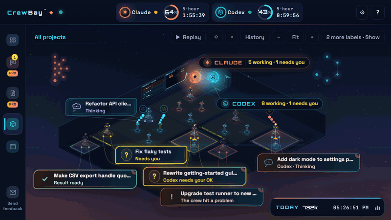
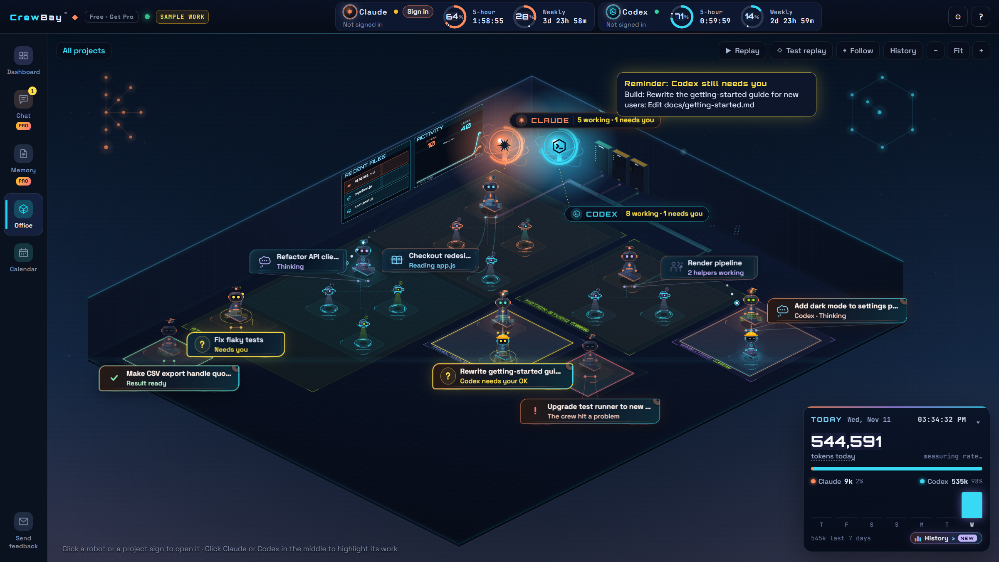

<h1 align="center">CrewBay</h1>

<p align="center">
  <b>A live office for your Claude Code and Codex sessions.</b><br>
  See which agent is working, which one is waiting on you, and which one broke something. At a glance.
</p>

<p align="center">
  <a href="https://github.com/Georgio-AA/crewscape-releases/releases/latest"><b>Download for Windows</b></a>
  ·
  <a href="https://crewbay.app">crewbay.app</a>
  ·
  <a href="https://discord.gg/P8cYmX4rm4">Discord</a>
</p>



## Why I built it

I run a lot of Claude Code and Codex sessions at once. The thing that kept costing me time
wasn't bad code. It was finding out one terminal had been sitting on "do you want to run this
command?" for twenty minutes while I was looking at another one.

CrewBay reads the logs Claude Code and Codex already keep on your computer and turns every
session into a robot in an isometric office. Each one stands in its project's room with a label
saying what it's doing right now.

- **Yellow** means it's waiting on you (a permission prompt, a question, a plan to approve).
- **Red** means something failed.
- **Green** means a result is ready.

## What you get for free

- **The live office.** Every Claude Code and Codex conversation, helper agent, background command
  and dev server it starts, linked to whatever started it.
- **Inbox.** Everything waiting on you in one list.
- **Both usage limits side by side.** Claude and Codex 5-hour and weekly limits, plus tokens per day.
- **History and replay.** Scroll back through what happened while you were away.

No account and no subscription needed for any of that.



## CrewBay Pro (optional)

Pro adds chats with Claude Code and Codex inside CrewBay, and **crews**: one AI plans and builds,
the other reviews, and they hand work to each other. It uses your own Claude and Codex accounts.
Pro has a **14-day free trial**, then it's $9/month.

## Privacy: what it reads, what it sends

**Reads:** the session logs Claude Code and Codex keep on your computer (`~/.claude` and `~/.codex`).
It never changes them.

**Sends nothing about your work.** The free office doesn't upload your logs, code or prompts
anywhere. The only things that leave your computer:

- **Update checks** to GitHub, a few times a day.
- **Claude usage**, to show your limits. It asks Anthropic with your own Claude Code sign-in.
  You can turn it off in Settings → Usage.

No ads, no tracking, no usage statistics. The full privacy note is at
[crewbay.app/privacy](https://crewbay.app/privacy.html).

## Install

1. Download `CrewBay-Setup-<version>-x64.exe` from the
   [latest release](https://github.com/Georgio-AA/crewscape-releases/releases/latest).
2. Run it. You need Claude Code, Codex, or both installed on the same computer.

**About the Windows warning.** CrewBay isn't code-signed yet (I'm one developer and signing
certificates cost a few hundred dollars a year). So Windows will probably show
"Windows protected your PC". Click **More info**, then **Run anyway**.

If you'd like to check the file first, every release lists its SHA-256 checksum. In PowerShell:

```powershell
Get-FileHash .\CrewBay-Setup-3.4.2-x64.exe -Algorithm SHA256
```

For 3.4.2 it should print `CCAD63882ECBAA6A1E73FDD62FFE71D7664608D4A38F0D683311AEABA92AE5A0`.

## Requirements

- Windows, 64-bit
- Claude Code and/or Codex, signed in with your own account

Mac and Linux aren't supported yet. If you'd use it there, open an issue and say so. That's
how I decide what to build next.

## FAQ

**Is it safe to run?**
It only reads the session logs Claude Code and Codex already write, and never changes them. Your
work isn't uploaded anywhere. See [Privacy](#privacy-what-it-reads-what-it-sends) above for the
complete list of what leaves your computer.

**Does it see sessions from the Claude desktop app?**
Claude Code sessions show up whether you started them in a terminal, an editor extension or the
Claude desktop app's Code tab. Regular Claude chats (not Claude Code) don't, because they aren't
stored on your computer.

**Do I need both Claude Code and Codex?**
No. One is enough. If you use both, they share the same office.

**Does it use my AI usage or need an API key?**
The free office runs no AI at all. It shows your limits using your existing Claude Code sign-in,
and you can turn that off. Pro's chats and crews run on your own Claude and Codex accounts.

**Is it really free?**
Yes. The office, Inbox, usage limits, history and replay are free with no account. Pro is optional.

**Mac or Linux?**
Not yet. If you'd use it, [open an issue](../../issues) so I know.

## Feedback

This is early, and I read everything. Found a bug, or want the office to show something it
doesn't? [Open an issue](../../issues) or come say hi on [Discord](https://discord.gg/P8cYmX4rm4).

---

CrewBay is free to use for personal and commercial work. It's closed source; this repository
holds the project page and issue tracker. The screenshots show demo data. Claude and Codex
belong to their owners; CrewBay is an independent app.
